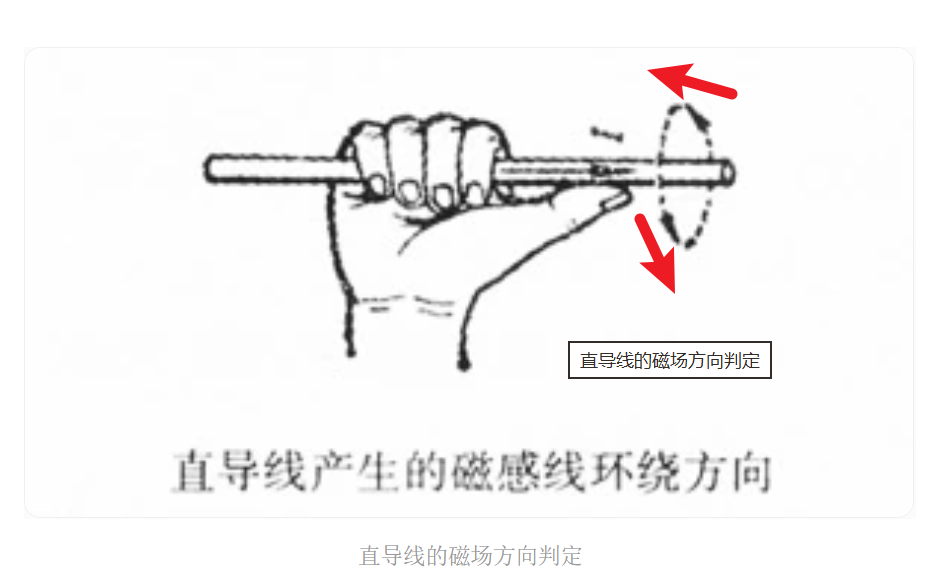
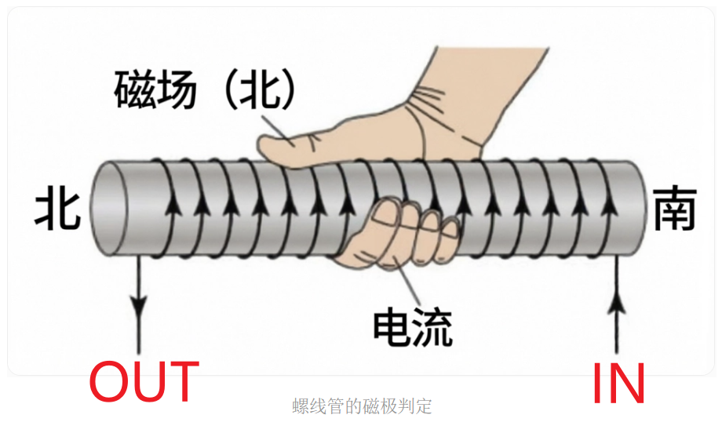

# 安培定则(右手定则)

## 直线电流的磁场方向判定

定则1**(直线电流的磁场方向判定)**：用右手握住通电直导线(电线、指铜丝)，让大拇指指向电流方向**(正电荷流动方向)**，那么这个时候四指方向就是通电导线周围的磁场方向。

## **环形电流或螺线管的磁极判定**

定则二**(螺线管的磁极判定)**：用右手握住通电螺线管，让四指指向电流的方向，那么大拇指的指向就是通电螺线管的N极(北极)。

