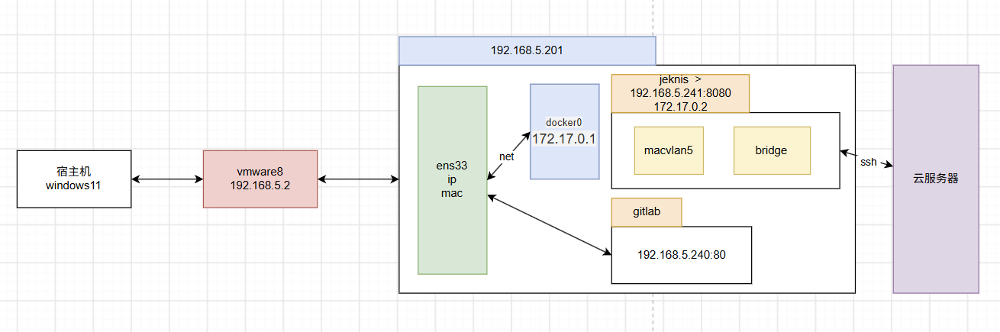
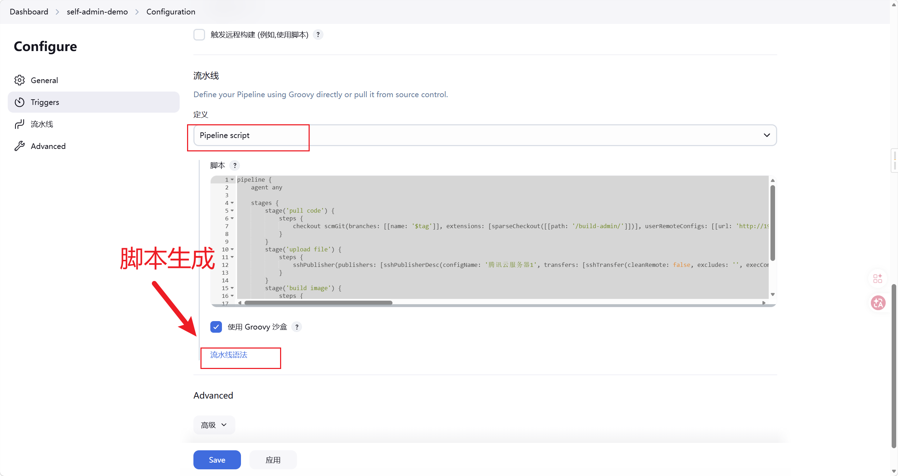

# 适合个人的ci/cd解决方案

## 环境介绍

windows11系统（宿主机）

wmware虚拟机软件。

centos7系统(虚拟机)。在系统上部署gitlab、jekins软件。docker容器部署。

服务器：

内存：8g够用，16g有余。

硬盘：40G。

4h

**总结：**

| 描述                  | 简介                                                         | ip                 |
| --------------------- | ------------------------------------------------------------ | ------------------ |
| centos7系统(虚拟机)   | 在系统上部署gitlab、jekins软件                               | 192.168.5.201      |
| windows11系统(宿主机) | 有当前局域网决定当前的网络段。虚拟机使用net模式接入当前局域网。 |                    |
| net网络模式           | 虚拟机与宿主机链接，虚拟机可以访问外网。                     |                    |
| gitlab                | 存放本地代码                                                 | 192.168.5.240      |
| jekins                | 触发流水线                                                   | 192.168.5.241:8080 |
| macvlan模式           | `macvlan` 是 Docker 的一种网络驱动，它的核心思想是：**让容器在二层网络（数据链路层）上“看起来像”一台独立的物理设备**，拥有自己的 MAC 地址和 IP，直接接入宿主机的物理网络，而不是像 `bridge` 模式那样躲在宿主机后面做 NAT。 |                    |
| bridge模式            | **Docker 建一个虚拟网桥 `docker0`，容器接在上面拿私有 IP，出网时经宿主机 NAT 伪装成宿主机 IP，入网时靠端口映射从宿主机转发进来**。它不要求底层网络环境有任何特殊能力，是兼容性最好、排查套路最成熟的网络模式。 |                    |

::: tip 当前存在的问题

jekins无法访问外网。因为是容器化部署。怎么解决？当前部署的是macvlan模式  。

:::

## 期望实现拓扑图

用户通过jekins将自己windows11上的工程触发流水线打包发送到目标云服务器上进行部署。



## macvlan的工作原理

```
        物理交换机 / 虚拟交换机（二层网络）
                    │
        ┌───────────┴────────────┐
        │       ens33            │  ← 宿主机真实网卡（parent）
        │  MAC: 00:11:22:33:44:55│
        │  IP:  192.168.5.100    │
        └───────────┬────────────┘
                    │
        ┌───────────┴────────────┐
        │   macvlan 子接口       │  ← Docker 基于 parent 创建的虚拟接口
        │   继承 parent 的二层   │     不是独立网卡，是 parent 的"分身"
        └───┬───────────────┬────┘
            │               │
      ┌─────┴─────┐   ┌─────┴─────┐
      │  容器A    │   │  容器B    │
      │ MAC: AA   │   │ MAC: BB   │  ← 每个容器有独立 MAC
      │ IP: .5.241│   │ IP: .5.242│  ← 与宿主机同网段的独立 IP
      └───────────┘   └───────────┘
```

**关键点**：

- `ens33` 是宿主机真实网卡，创建 macvlan 网络时通过 `--parent=ens33` 指定。
- Docker 基于 `ens33` 创建 macvlan 子接口，容器通过这个子接口直接收发二层帧。
- **每个容器有独立的 MAC 地址和独立 IP**，在二层网络上看起来就是两台独立设备。
- 容器的 IP 与宿主机**同一网段**（如都是 `192.168.5.x`），网关也相同（如 `192.168.5.1`）。

 数据包怎么流转？

**场景一：容器访问外网（出网）**

以容器 A（`192.168.5.241`）访问腾讯云为例：

1. 容器 A 发出包，源 IP `192.168.5.241`，源 MAC `AA`，目标 MAC 是网关 `192.168.5.1` 的 MAC。
2. 帧从 macvlan 子接口发出，**直接经 `ens33` 进入二层网络**（虚拟交换机 / 物理交换机）。
3. 交换机根据目标 MAC 把帧转发给网关 `192.168.5.1`。
4. 网关做三层路由，把包转发到外网。
5. **宿主机内核全程不参与**——不经过 `docker0`，不走 `ip_forward`，不做 `MASQUERADE`。容器 IP 在出网时**保持不变**，目标服务器看到的就是 `192.168.5.241`。

**场景二：局域网设备访问容器（入网）**

局域网内另一台设备（如 `192.168.5.50`）直接访问 `192.168.5.241:8080`：

1. 设备发出 ARP 请求"谁是 192.168.5.241"，容器 A 用自己的 MAC `AA` 应答。
2. 设备直接把帧发给 MAC `AA`，经交换机到达 `ens33`，再由 macvlan 子接口交给容器 A。
3. **不需要端口映射**，容器 IP 直接可达。

## bridge的工作原理

Docker 启动时会创建一个名为 `docker0` 的**虚拟网桥**（本质上是一个软件交换机），宿主机和所有使用 bridge 网络的容器都接在这台"虚拟交换机"上。

```
       外部网络（虚拟机 NAT 网络 / 物理网络）
                │
        ┌───────┴────────┐
        │    ens33       │  ← 虚拟机网卡（宿主机真实网卡）
        │ 192.168.100.10 │
        └───────┬────────┘
                │  NAT（iptables MASQUERADE）
        ┌───────┴────────┐
        │    docker0     │  ← Docker 虚拟网桥（软件交换机）
        │  172.17.0.1    │     宿主机的网关地址
        └───┬───────┬────┘
            │       │
      ┌─────┴──┐ ┌──┴─────┐
      │ 容器A  │ │ 容器B  │
      │.17.0.2 │ │.17.0.3 │
      └────────┘ └────────┘
```

**容器出网路径**（以 Jenkins SSH 到腾讯云为例）：

```
Jenkins 容器 (172.17.0.5)
    │  目标：腾讯云 IP:22，源 IP：172.17.0.5
    ↓
docker0 网桥 (172.17.0.1)  ← 容器默认网关
    ↓
宿主机内核路由 + iptables
    │  ① ip_forward=1      → 允许转发
    │  ② FORWARD 链 ACCEPT → 允许通过
    │  ③ MASQUERADE         → 源 IP 改写为 192.168.100.10
    ↓
ens33 (192.168.100.10)  ← 源 IP 已被 NAT 成宿主机 IP
    ↓
虚拟机 NAT 网络 → 外网 → 腾讯云服务器
```

**关键点**：腾讯云服务器看到的源 IP 是**宿主机的 IP**，而不是容器 IP。回包也回到宿主机，再由宿主机根据 NAT 连接跟踪表转发回容器。整个过程中，容器对目标服务器是"隐身"的，这就是为什么需要 `ip_forward`、`FORWARD` 链、`MASQUERADE` 这三件套正常工作——它们正是你之前排查 bridge 网络问题时反复提到的检查项

## macvlan和bridge拓扑的核心差异

| 对比项         | bridge                                  | macvlan                                   |
| :------------- | :-------------------------------------- | :---------------------------------------- |
| 拓扑位置       | 容器接在 `docker0` 虚拟网桥后面         | 容器直接接在 `ens33` 所在的二层网络       |
| 容器 IP        | 私有 `172.17.0.x`                       | 与宿主机同网段 `192.168.5.x`              |
| 容器 MAC       | 虚拟 MAC，对外不可见                    | 独立 MAC，二层可见                        |
| 出网路径       | 容器 → docker0 → 宿主机 NAT → ens33     | 容器 → macvlan 子接口 → ens33（无 NAT）   |
| 宿主机内核参与 | **深度参与**（路由、iptables、NAT）     | **几乎不参与**（只做二层转发）            |
| 外部访问容器   | 必须端口映射                            | 直接访问容器 IP                           |
| 网关来源       | Docker 创建的 `docker0`（`172.17.0.1`） | 二层网络中真实存在的网关（`192.168.5.1`） |

**一句话对比**：bridge 是"容器躲在宿主机后面，宿主机做代理"；macvlan 是"容器和宿主机平起平坐，都是二层网络里的独立设备"。

## 查Docker各网络定义的网关（网络层面的配置）

第一步：列出所有 Docker 网络。

```shell
docker network ls
```

如：

```shell
NETWORK ID     NAME       DRIVER    SCOPE
62da3553c9a7   bridge     bridge    local
31f99926fd75   host       host      local
965b7e255a87   macvlan5   macvlan   local

```

第二步：查看某个网络的详细配置，重点看 "Gateway" 字段。

```shell
docker network inspect macvlan5
docker network inspect bridge
```

如：docker network inspect bridge

```json
[
    {
        "Name": "bridge",
        "Id": "62da3553c9a71284dc658964633b20c3dc18c134a2b0b8c5aa1fe9c9d188cd25",
        "Created": "2026-11-15T07:18:53.124952308+08:00",
        "Scope": "local",
        "Driver": "bridge",
        "EnableIPv6": false,
        "IPAM": {
            "Driver": "default",
            "Options": null,
            "Config": [
                {
                    "Subnet": "172.17.0.0/16",
                    "Gateway": "172.17.0.1"
                }
            ]
        },
        "Internal": false,
        "Attachable": false,
        "Ingress": false,
        "ConfigFrom": {
            "Network": ""
        },
        "ConfigOnly": false,
        "Containers": {
            "6f4daa421264144ff9b8c4b7431aef0eeda082eed18d994a4421bd40d7f9f50d": {
                "Name": "jenkins",
                "EndpointID": "c5fb67068569a6b6c5e317e7b43adf9a354451a253b1461c276704931201956c",
                "MacAddress": "02:42:ac:11:00:02",
                "IPv4Address": "172.17.0.2/16",
                "IPv6Address": ""
            }
        },
        "Options": {
            "com.docker.network.bridge.default_bridge": "true",
            "com.docker.network.bridge.enable_icc": "true",
            "com.docker.network.bridge.enable_ip_masquerade": "true",
            "com.docker.network.bridge.host_binding_ipv4": "0.0.0.0",
            "com.docker.network.bridge.name": "docker0",
            "com.docker.network.driver.mtu": "1500"
        },
        "Labels": {}
    }
]
```

## 查看jenkins的路由表

```shell
docker run --rm --network=container:jenkins busybox ip route
```

输出：

```
[root@cicd ~]# docker run --rm --network=container:jenkins busybox ip route
default via 172.17.0.1 dev eth1 
172.17.0.0/16 dev eth1 scope link  src 172.17.0.2 
192.168.5.0/24 dev eth0 scope link  src 192.168.5.241 
```

**第 1 行：`default via 172.17.0.1 dev eth1`**

- 这是**唯一的默认路由**，没有第二条 `default`。
- 所有不属于下面两个直连子网的目标地址（外网、腾讯云、公网 DNS 等），都走这条。
- 网关是 `172.17.0.1`（`docker0` 网桥地址），出口网卡是 `eth1`（bridge 网络的网卡）。
- **关键：macvlan 的 `default via 192.168.5.1` 不在了**。Docker 在多网络下只给一个网络配默认网关，这里选中了 bridge。

**第 2 行：`172.17.0.0/16 dev eth1 scope link src 172.17.0.2`**

- 直连路由：目标在 `172.17.0.0/16` 网段内时，直接从 `eth1` 发出，不经过网关。
- `src 172.17.0.2` 是容器在 bridge 网络里的 IP，作为源地址。
- 用于访问同宿主机上的其他 bridge 容器。

**第 3 行：`192.168.5.0/24 dev eth0 scope link src 192.168.5.241`**

- 直连路由：目标在 `192.168.5.0/24` 网段内时，直接从 `eth0`（macvlan 网卡）发出。
- `src 192.168.5.241` 是容器在 macvlan 网络里的 IP。
- **注意：这一行只是"如果目标在这个网段内，就走 macvlan"，但它没有配套的默认路由**。所以访问 `192.168.5.x` 以外的地址时，不会走 macvlan。

| 目标地址                         | 走哪条路由          | 出口网卡             | 源 IP                               | 是否 NAT |
| :------------------------------- | :------------------ | :------------------- | :---------------------------------- | :------- |
| `172.17.0.x`                     | 第 2 行直连         | `eth1`（bridge）     | `172.17.0.2`                        | 否       |
| `192.168.5.x`                    | 第 3 行直连         | `eth0`（macvlan）    | `192.168.5.241`                     | 否       |
| **其他所有地址**（腾讯云、外网） | **第 1 行默认路由** | **`eth1`（bridge）** | `172.17.0.2` → 经 NAT 变为宿主机 IP | **是**   |

**出网（SSH 到腾讯云、拉 Maven 依赖、访问公网）走的是 `172.17.0.1` → bridge → 宿主机 NAT**。这正是我们想要的状态。

## 查看jekins容器的网络模式有哪些？

使用命令inspect：

```
docker inspect jenkins --format='{{json .NetworkSettings}}'
```

输出的是json字符串，下面的使用工具格式化后的展示效果：

```json
{
  "Bridge": "",
  "SandboxID": "a8bb30bd3cc717aa8f5b9052fbaa22162290ead4598f78173171491902c8094b",
  "SandboxKey": "/var/run/docker/netns/a8bb30bd3cc7",
  "Ports": {
    "50000/tcp": null,
    "8080/tcp": null
  },
  "HairpinMode": false,
  "LinkLocalIPv6Address": "",
  "LinkLocalIPv6PrefixLen": 0,
  "SecondaryIPAddresses": null,
  "SecondaryIPv6Addresses": null,
  "EndpointID": "c5fb67068569a6b6c5e317e7b43adf9a354451a253b1461c276704931201956c",
  "Gateway": "172.17.0.1",
  "GlobalIPv6Address": "",
  "GlobalIPv6PrefixLen": 0,
  "IPAddress": "172.17.0.2",
  "IPPrefixLen": 16,
  "IPv6Gateway": "",
  "MacAddress": "02:42:ac:11:00:02",
  "Networks": {
    "bridge": {
      "IPAMConfig": {},
      "Links": null,
      "Aliases": [],
      "MacAddress": "02:42:ac:11:00:02",
      "NetworkID": "62da3553c9a71284dc658964633b20c3dc18c134a2b0b8c5aa1fe9c9d188cd25",
      "EndpointID": "c5fb67068569a6b6c5e317e7b43adf9a354451a253b1461c276704931201956c",
      "Gateway": "172.17.0.1",
      "IPAddress": "172.17.0.2",
      "IPPrefixLen": 16,
      "IPv6Gateway": "",
      "GlobalIPv6Address": "",
      "GlobalIPv6PrefixLen": 0,
      "DriverOpts": {},
      "DNSNames": null
    },
    "macvlan5": {
      "IPAMConfig": {
        "IPv4Address": "192.168.5.241"
      },
      "Links": null,
      "Aliases": null,
      "MacAddress": "02:42:c0:a8:05:f1",
      "NetworkID": "965b7e255a87994e316cb4d59018ba6b382962302f7a040a9bfd8edbadb2ea1c",
      "EndpointID": "29c7acb748799c0aeaf4c18faded97e72005575674c9e0a377c8a651a72304f5",
      "Gateway": "192.168.5.1",
      "IPAddress": "192.168.5.241",
      "IPPrefixLen": 24,
      "IPv6Gateway": "",
      "GlobalIPv6Address": "",
      "GlobalIPv6PrefixLen": 0,
      "DriverOpts": null,
      "DNSNames": [
        "jenkins",
        "6f4daa421264"
      ]
    }
  }
}
```

可以看到jekins的容器使用了二种网络模式：bridge、macvlan5。

使用命令inspect查看gitlab容器：

```shell
docker inspect gitlab  --format='{{json .NetworkSettings}}'
```

输出的是json字符串，下面的使用工具格式化后的展示效果：

```json
{
  "Bridge": "",
  "SandboxID": "fad9c118c2e8299b4b7ed8f1da8e00a31ef144cfeb1886b354567ba845a89b2e",
  "SandboxKey": "/var/run/docker/netns/fad9c118c2e8",
  "Ports": {},
  "HairpinMode": false,
  "LinkLocalIPv6Address": "",
  "LinkLocalIPv6PrefixLen": 0,
  "SecondaryIPAddresses": null,
  "SecondaryIPv6Addresses": null,
  "EndpointID": "",
  "Gateway": "",
  "GlobalIPv6Address": "",
  "GlobalIPv6PrefixLen": 0,
  "IPAddress": "",
  "IPPrefixLen": 0,
  "IPv6Gateway": "",
  "MacAddress": "",
  "Networks": {
    "macvlan5": {
      "IPAMConfig": {
        "IPv4Address": "192.168.5.240"
      },
      "Links": null,
      "Aliases": null,
      "MacAddress": "02:42:c0:a8:05:f0",
      "NetworkID": "965b7e255a87994e316cb4d59018ba6b382962302f7a040a9bfd8edbadb2ea1c",
      "EndpointID": "99d0da8b7000ed2608b1382691c2c0fe9915f4fdeefc163ad8ba7fddeb368444",
      "Gateway": "192.168.5.1",
      "IPAddress": "192.168.5.240",
      "IPPrefixLen": 24,
      "IPv6Gateway": "",
      "GlobalIPv6Address": "",
      "GlobalIPv6PrefixLen": 0,
      "DriverOpts": null,
      "DNSNames": [
        "gitlab",
        "4b193b973713",
        "gitlab.example.com"
      ]
    }
  }
}
```


## jekins无法访问外网问题解决

解决：**双网络接口**Jenkins 同时接入 bridge 和 macvlan  

优点：无需额外容器，利用 Docker 原生功能  。

缺点：需要处理容器内的多默认路由冲突。

**第一步：为容器连接一个 bridge 网络**

Docker 默认的 `bridge` 网络就可以用。执行以下命令，为现有的 Jenkins 容器额外接入 `bridge` 网络：

```shell
docker network connect bridge jenkins
```

执行后，容器内部会多出一块网卡（通常是 `eth1`），并可能获得一个 `172.17.0.x` 的地址。

**验证配置是否生效**

配置完成后，**用之前的方法，启动一个临时 BusyBox 容器共享 Jenkins 的网络进行验证**，这是最准确的方式：

```shell
docker run --rm --network=container:jenkins busybox sh -c '
echo "===== 路由表 =====";
ip route;
echo "===== 外网连通性 (ping 223.5.5.5) =====";
ping -c 3 223.5.5.5;
echo "===== 目标 TCP 22 测试 =====";
nc -zv -w 3 <腾讯云真实IP> 22;
'
```

**判读标准**：

- `ip route` 的输出中，`default via` 应该指向 `bridge` 网络的网关（通常是 `172.17.0.1`），**而不是** `192.168.5.1`。
- `ping 223.5.5.5` 应该能收到回包。
- `nc -zv <腾讯云IP> 22` 应该显示连接成功。

一旦验证通过，回到 Jenkins 的 Publish over SSH 面板重新测试，应该就能正常建立连接了。


## 最终jekins配置



最终脚本，参考修改。

```groovy
pipeline {
    agent any

    stages {
        stage('pull code') {
            steps {
                checkout scmGit(branches: [[name: '$tag']], extensions: [sparseCheckout([[path: '/build-admin/']])], userRemoteConfigs: [[url: 'http://192.168.5.240/front_end_project_group/selfendadmin']])
            }
        }
        stage('upload file') {
            steps {
                sshPublisher(publishers: [sshPublisherDesc(configName: '腾讯云服务器1', transfers: [sshTransfer(cleanRemote: false, excludes: '', execCommand: '', execTimeout: 120000, flatten: false, makeEmptyDirs: false, noDefaultExcludes: false, patternSeparator: '[, ]+', remoteDirectory: '/ruoyi-end/', remoteDirectorySDF: false, removePrefix: 'build-admin', sourceFiles: 'build-admin/*')], usePromotionTimestamp: false, useWorkspaceInPromotion: false, verbose: false)])
            }
        }
        stage('build image') {
            steps {
                sshPublisher(publishers: [sshPublisherDesc(configName: '腾讯云服务器1', transfers: [sshTransfer(cleanRemote: false, excludes: '', execCommand: "cd /usr/local/ruoyi-end && docker build -t ruoyi-springboot3:$tag .", execTimeout: 120000, flatten: false, makeEmptyDirs: false, noDefaultExcludes: false, patternSeparator: '[, ]+', remoteDirectory: '/ruoyi-end/', remoteDirectorySDF: false, removePrefix: '', sourceFiles: '', usePty: true)], usePromotionTimestamp: false, useWorkspaceInPromotion: false, verbose: false)])
            }
        }
    }
}
```


